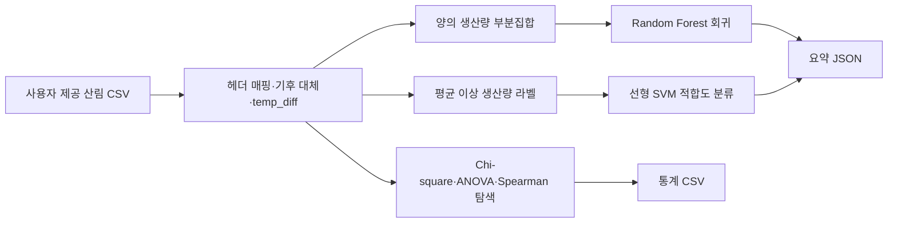

# 산림 작물 적합지·생산량 분석

[English](README.md) · [사례 연구](PORTFOLIO.ko.md)

단기 임산물 7종을 대상으로 한 재배 적합지 분석과 지도 서비스 구상입니다. 토양·기후·생산량 데이터를 연결했고, GIS 토양·토양수분 shapefile은 GeoPandas로 처리했습니다.

**문제.** 예비 임업인은 먼저 작물과 재배지를 정해야 하지만, 토양·기후·생산량 자료는 서로 다른 공공 데이터에 흩어져 있습니다. 작물마다 어떤 조건에서 생산량이 평균 이상이고, 그 조건에 맞는 지역은 어디일까요?

**결과.** 평균 이상 생산량 분류에서 평가 AUC는 밤 0.94, 마 0.91, 복분자딸기 0.84였습니다(우연 수준 0.5, 다수 클래스 기준선은 실행하지 않음). 모든 작물에 맞는 단일 모델은 없어서 밤에는 Logistic Regression, 마에는 SVM, 복분자딸기에는 Random Forest를 골랐습니다.

**역할.** 팀 출품작이며, 이 저장소의 분석 코드와 문서를 직접 작성했습니다.

**범위.** 평가 세트 양성 사례가 약 2~5건이어서 작물별 모델 간 차이는 AUC 잡음 범위 안에 있습니다. 이 저장소의 CLI(`python run_pipeline.py`)는 선별용 통계(Chi-square·ANOVA·Spearman), Random Forest 생산량 회귀, 선형 SVM 분류만 재구현합니다. 위의 작물별 모델 선택과 AUC는 대회 당시 분석 결과(ROC 그림은 `images/`)이며, 분석용 CSV는 포함되어 있지 않습니다.

**수상.** 2024년 임업통계 스마트활용 경진대회 대상(산림청장상, 1위), 산림청·한국임업진흥원(2024.12.13).

## 결과

| 작물 | 선택한 모델 | 평가 AUC | 평가 세트 양성 사례(추정) |
|---|---|---:|---:|
| 밤 | Logistic Regression | 0.94 | 5 |
| 마 | SVM | 0.91 | 2 |
| 복분자딸기 | Random Forest | 0.84 | 4 |

작물마다 SVM·Random Forest·Logistic Regression을 AUC로 비교해 모델을 골랐습니다. 생표고·더덕·오갈피도 Random Forest, 도라지는 Logistic Regression이 선택됐습니다. 양성 사례 수는 각 ROC 곡선의 계단 크기에서 읽었습니다(`images/roc_*.png`).

변수 선별:

- 토양 변수(범주형): Chi-square·ANOVA에서 p < 0.1인 변수를 남겼습니다.
- 기후 변수: 생산량과의 상관계수 |r| >= 0.2인 변수를 남겼습니다.
- 도메인 점검: 밤의 상위 토양 변수는 양토(토성코드_1)였고, 일반적인 밤 재배 권고와 일치합니다.

## 작동 방식

토양·기후 변수를 거르고, 생산량이 0보다 큰 행에서 생산량을 예측하며, 작물 평균 이상 생산량을 '적합'으로 라벨링합니다. 출처: `data/임업통계 데이터 셋 출처(이준형).txt`.



| 단계 | 구현 내용 |
|---|---|
| 로딩 | `DataLoader`가 원래의 한글 헤더를 매핑하거나 `chestnut_kg`, `avg_temp`, `humidity`, `precipitation` 같은 영문 헤더를 받습니다. 기후 결측치는 컬럼 평균으로 채우고, 최고·최저 기온으로 `temp_diff`를 만듭니다. |
| 통계 점검 | `StatAnalyzer`: 토양 범주와 양의 생산량 분위수 구간의 연관성, 일원 ANOVA, Spearman 상관. |
| 회귀 | `CropPredictor`가 양의 생산량만 남기고 피처를 one-hot 인코딩한 뒤 median imputation+Random Forest 파이프라인을 학습합니다. 80/20 holdout R²/MSE와 셔플 CV R²를 출력합니다(seed 42). |
| 적합도 분류 | `CropClassifier`가 학습 분할 평균(같은 기준값을 평가 분할에도 적용) 이상 생산량을 적합으로 라벨링하고, imputation·scaling·선형 SVM을 한 파이프라인에서 층화 80/20 분할과 층화 CV로 실행합니다(seed 42). |
| 산출물 | `run_pipeline.py`가 Chi-square·ANOVA·Spearman 표와 JSON 모델 요약을 `results/`에 저장합니다. |

## 그림


*그림 1. 발표 자료 8쪽: 작물·재배지 추천용 토양·기후 입력과, 함께 제공하는 정보 화면용 판매·가격·지역 생산량 입력입니다.*


*그림 2. 기후 변수와 작물 생산량 컬럼 사이의 상관입니다.*


*그림 3. 밤 ROC 곡선, AUC 0.94. 0.2 단위로 올라가므로 평가 세트의 양성 사례는 약 5건입니다.*

## 실행 방법

```powershell
pip install -r requirements.txt

python run_pipeline.py `
  --input-csv path\to\forestry_data.csv `
  --crop chestnut_kg `
  --features avg_temp humidity precipitation soil_depth_type soil_texture_code
```

헤더가 다르면 `--crop`, `--features`로 지정합니다. 기본 `--encoding`은 `cp949`이고, 실패하면 UTF-8을 시도합니다. 실행하면 `results/`에 `<crop>_chi_square.csv`, `<crop>_anova.csv`, `<crop>_spearman.csv`, `<crop>_summary.json`이 저장됩니다.

노트북은 Python 3.12.4(Anaconda)에서 실행했습니다. `requirements.txt`는 pandas·numpy·scipy·matplotlib을 노트북 pip 출력에 기록된 버전으로 고정했고, 기록이 없는 scikit-learn은 2026-11 점검 환경 버전으로 고정했습니다.

## 저장소 구조

```text
src/                  # 설정, 로딩, 통계, 모델
run_pipeline.py        # CLI 진입점과 결과 저장
notebooks/             # 탐색·GIS 노트북
images/                # 대시보드, 히트맵, ROC 그림
reports/               # 최종 보고서와 발표 자료(PDF)
data/                  # 출처 메모, 원본 분석 CSV는 미포함
```

## 한계

- 평가 세트의 양성 사례가 약 2~5건이어서 작물별 모델 간 차이는 AUC 잡음 범위 안에 있습니다. 분석 CSV가 포함되지 않아 AUC를 다시 계산할 수 없습니다.
- AUC는 7개 작물 중 3개만 남아 있고, 모델별 비교표는 없습니다.
- 공간·시간 holdout이 없어 인접 지역이 학습·평가 세트에 함께 들어갔을 수 있습니다.
- '적합'은 작물 평균 이상이라는 통계적 기준이지 농학적 기준이 아니며, 등급은 연관성을 보여 줄 뿐 조건을 바꾸면 생산량이 바뀐다는 뜻이 아닙니다.

## 다음 단계

- 지역 단위로 하나씩 빼는 분할로 평가하고, AUC에 부트스트랩 구간을 붙이며, 다수 클래스·단일 변수 기준선을 추가합니다.
- 평균 이상 라벨을 전문가와 합의한 농학적 기준으로 바꾸고, 지도를 실제 재배지와 대조합니다.

## 문서

- [사례 연구](PORTFOLIO.ko.md)
- [아키텍처](docs/ARCHITECTURE.md)

## 라이선스

오픈소스 라이선스 없음: 코드와 문서는 열람용으로 공개하며, 재사용하려면 허락이 필요합니다.
