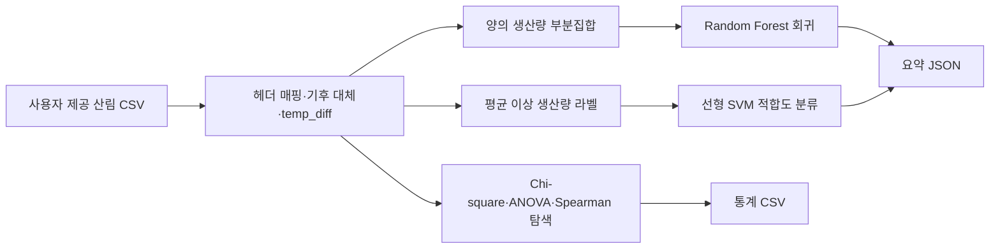

# 산림 작물 적합지·생산량 분석

[English](README.md) · [사례 연구](PORTFOLIO.ko.md)

밤·마·복분자딸기 등 단기 임산물 7종의 토양·기후·생산량 데이터(GeoPandas로 처리한 GIS 토양·토양수분 shapefile 포함)를 연결해, 작물별로 잘 자랄 만한 지역을 찾습니다. 결과는 지도 기반 추천 서비스 구상으로 정리했습니다.

**의사결정 질문.** 작물마다 어떤 토양·기후 조건이 평균 이상의 생산량과 함께 나타나고, 그 조건에 맞는 지역은 어디인가?

**결과.** 모든 작물에 맞는 단일 모델은 없었습니다. 최종 보고서는 마에 SVM, 복분자딸기·생표고·더덕·오갈피에 Random Forest, 밤·도라지에 Logistic Regression을 골랐습니다. 평균 이상 생산량 분류에서 보관된 ROC 그림은 AUC 0.94(밤), 0.91(마), 0.84(복분자딸기)를 보여 주며, 평가 세트의 양성 사례는 약 2~5건입니다.

**수상.** 2024년 임업통계 스마트활용 경진대회 대상(산림청장상, 1위), 산림청·한국임업진흥원(2024.12.13). 팀 출품작입니다.

## 작동 방식

토양·기후 변수를 거르고, 양의 생산량 행에서 생산량을 예측하며, 작물 평균 이상 생산량을 '적합'으로 라벨링합니다. 출처: `data/임업통계 데이터 셋 출처(이준형).txt`.



| 단계 | 구현 내용 |
|---|---|
| 로딩 | `DataLoader`가 기존 한글 헤더를 매핑하거나 `chestnut_kg`, `avg_temp`, `humidity`, `precipitation` 같은 영문 헤더를 받습니다. 기후 결측치는 컬럼 평균으로 채우고, 최고·최저 기온으로 `temp_diff`를 만듭니다. |
| 통계 점검 | `StatAnalyzer`: 토양 범주와 양의 생산량 분위수 구간의 연관성, 일원 ANOVA, Spearman 상관. |
| 회귀 | `CropPredictor`가 양의 생산량만 남기고 특성을 one-hot 인코딩한 뒤 median imputation+Random Forest 파이프라인을 학습합니다. 80/20 홀드아웃 R²/MSE와 셔플 CV R²를 기록합니다(seed 42). |
| 적합도 분류 | `CropClassifier`가 전체 입력의 평균 이상 생산량을 적합으로 라벨링하고, imputation·scaling·선형 SVM을 한 파이프라인에서 층화 80/20 분할과 층화 CV로 실행합니다(seed 42). |
| 산출물 | `run_pipeline.py`가 Chi-square·ANOVA·Spearman 표와 JSON 모델 요약을 `results/`에 저장합니다. |

## 그림

그림 1·2는 발표 자료 PDF(`reports/*_ppt.pdf`)에서 렌더링했습니다.


*그림 1. 발표 자료 8쪽: 작물·지역 추천용 토양·기후 입력과, 함께 제공하는 정보 화면용 판매·가격·지역 생산량 입력입니다.*


*그림 2. 발표 자료 23쪽: 시장 동향·지역 생산 지도 예시입니다.*


*그림 3. 지도·추천·시장 정보 화면 구상 콜라주입니다.*


*그림 4. 필터링한 과거 데이터에서 기후 변수와 작물 생산량 컬럼의 상관입니다.*


*그림 5. 밤 ROC 곡선, AUC 0.94. 0.2 단위로 올라가므로 평가 세트의 양성 사례는 약 5건입니다.*

## 결과

| 작물 | 보고서가 고른 모델 | ROC 그림의 AUC | 평가 세트 양성 사례(추정) | 출처 |
|---|---|---:|---:|---|
| 밤 | Logistic Regression | 0.94 | 5 | `images/roc_chestnut.png` |
| 마 | SVM | 0.91 | 2 | `images/roc_yam.png` |
| 복분자딸기 | Random Forest | 0.84 | 4 | `images/roc_blackberry.png` |

양성 사례 수는 각 ROC 곡선의 계단 크기에서 읽은 값이고, 비교 기준은 무작위 대각선(AUC 0.5)입니다. 작물별 모델은 보고서 자체의 AUC 비교로 골랐습니다.

보고서의 변수 선별:

- 토양 변수(범주형): Chi-square·ANOVA에서 p < 0.1인 변수를 남겼습니다.
- 기후 변수: 생산량과의 상관계수 |r| >= 0.2인 변수를 남겼습니다.
- 도메인 점검: 밤의 상위 토양 변수는 양토(토성코드_1)였고, 일반적인 밤 재배 권고와 일치합니다.

## 실행

```powershell
pip install -r requirements.txt

python run_pipeline.py `
  --input-csv path\to\forestry_data.csv `
  --crop chestnut_kg `
  --features avg_temp humidity precipitation soil_depth_type soil_texture_code
```

헤더가 다르면 `--crop`, `--features`로 지정합니다. 기본 `--encoding`은 `cp949`이고 이어서 UTF-8을 시도합니다. 실행하면 `results/`에 `<crop>_chi_square.csv`, `<crop>_anova.csv`, `<crop>_spearman.csv`, `<crop>_summary.json`이 저장됩니다.

## 저장소 구조

```text
src/                  # 설정, 로딩, 통계, 모델
run_pipeline.py        # CLI 진입점과 결과 저장
notebooks/             # 과거 탐색·GIS 노트북
images/                # 대시보드, 히트맵, ROC 산출물
reports/               # 과거 보고서 PDF
data/                  # 출처 메모, 원본 분석 CSV 제외
```

## 한계

- 분석 CSV가 포함되지 않아 행 수·기간·공간 단위·원래 분할을 확인할 수 없고, 위 AUC는 재실행하지 않았습니다.
- 평가 세트의 양성 사례가 약 2~5건(ROC 참양성률 계단 0.2~0.5)이어서 작물별 모델 간 차이는 AUC 잡음 범위 안에 있습니다.
- 나머지 4개 작물의 AUC와 모델별 비교표는 남아 있지 않으며, ROC 그림 제목에는 모델이 아니라 작물 이름만 있습니다.
- 다수 클래스·단일 변수 기준선, 보정(calibration), 불확실성 구간, 저장된 모델 산출물이 없습니다.
- 공간·시간 홀드아웃이 없어 인접 지역이 학습·평가 세트에 함께 들어갔을 수 있습니다.
- '적합'은 작물 평균 이상이라는 통계적 기준이며, 농학적 기준이 아닙니다.
- 변수 선별은 느슨한 기준과 많은 검정을 다중 비교 보정 없이 사용했고, 범주를 숫자로 바꾼 Spearman 상관은 탐색용입니다.
- 상관과 변수 중요도는 연관성을 보여 줄 뿐, 조건을 바꾸면 생산량이 바뀐다는 뜻이 아닙니다.
- 보고서의 원래 코드는 분할 전에 전체 데이터로 표준화했습니다(작은 누수). 유지되는 분류기는 학습 파이프라인 안에서 스케일링합니다.
- 지도와 대시보드는 디자인 구상이며, 배포된 서비스는 없습니다.
- 라이선스 파일이 없어 코드는 기본적으로 모든 권리가 저작권자에게 있습니다.

## 문서

- [포트폴리오 사례 연구](PORTFOLIO.ko.md)
- [프로젝트 리뷰](docs/PROJECT_REVIEW.md)
- [아키텍처](docs/ARCHITECTURE.md)
- [CV 문구 가이드](docs/CV_BULLETS.md)
