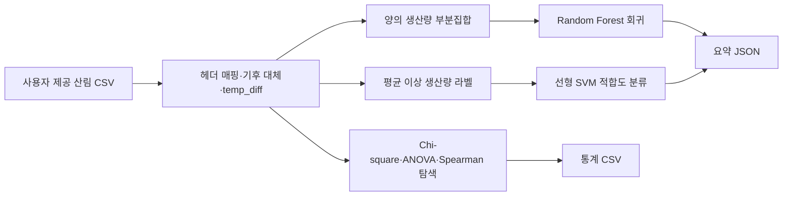

# 산림 작물 적합지·생산량 분석

[English](README.md) · [사례 연구](PORTFOLIO.ko.md)

밤·마·복분자딸기 등 단기 임산물 7종의 토양·기후·생산량 데이터를 연결해 작물별로 잘 자랄 만한 지역을 찾고, 그 결과를 지도 기반 추천 서비스 구상으로 정리한 프로젝트입니다.

**의사결정 질문.** 예비 임업인은 먼저 어떤 작물을 어디서 키울지 정해야 합니다. 작물마다 어떤 토양·기후 조건이 평균 이상의 생산량과 함께 나타나고, 그 조건에 맞는 지역은 어디인가?

**핵심 결과.** 모든 작물에 맞는 단일 모델은 없었습니다. 통계 검정으로 변수를 거른 뒤, 최종 보고서는 마에 SVM, 복분자딸기·생표고·더덕·오갈피에 Random Forest, 밤·도라지에 Logistic Regression을 골랐습니다. 평균 이상 생산량 분류에서 보관된 ROC 그림은 밤 AUC 0.94, 마 0.91, 복분자 0.84를 보여 줍니다. 다만 평가 세트가 매우 작았습니다. 곡선의 참양성률이 0.2~0.5 단위로 움직이므로 양성 사례는 약 2~5건입니다. 이 AUC는 변동이 큰 과거 결과로 읽어야 하며, 벤치마크가 아닙니다.

**수상.** 2024년 임업통계 스마트활용 경진대회 대상(산림청장상, 1위), 산림청·한국임업진흥원(2024.12.13). 팀 출품작이며, 이 저장소에는 개인별 업무 분담이 기록되어 있지 않습니다.

> **근거 범위:** 원본 분석 CSV는 포함하지 않습니다. 소스 링크, 노트북, 코드, 보고서 PDF, 보관 그림은 남아 있지만, 원래 입력 데이터와 컬럼 헤더 없이는 과거 점수를 다시 만들 수 없습니다.

## 문제와 데이터 범위

워크플로는 토양·기후 변수와 양의 생산량의 관계를 걸러 보고, 양의 생산량 행에서 생산량을 예측하며, 작물 평균 이상 생산량을 '적합'으로 분류합니다. `data/임업통계 데이터 셋 출처(이준형).txt`에는 통계·토양·기후·생산량 데이터 출처가 적혀 있지만 분석 CSV는 없습니다. 따라서 행 수·기간·공간 단위·타깃 정의·원래 분할은 이 저장소에서 확인할 수 없습니다.

`src/data_loader.DataLoader`는 기존 한글 헤더 또는 `chestnut_kg`, `avg_temp`, `humidity`, `precipitation` 같은 영문 헤더를 처리합니다. 기후 결측치는 컬럼 평균으로 채우고, 최고·최저 기온이 있으면 `temp_diff`를 만듭니다.

## 유지되는 흐름



| 단계 | 구현 내용 |
|---|---|
| 통계 점검 | `StatAnalyzer`가 양의 생산량 분위수 구간, 일원 ANOVA, Spearman 상관을 계산합니다. 인과 추정이 아닌 탐색입니다. |
| 회귀 | `CropPredictor`가 양의 생산량만 사용해 median imputation+Random Forest 파이프라인을 학습하고, 80/20 홀드아웃 R²/MSE와 CV R²를 기록합니다(seed 42). |
| 분류 | `CropClassifier`는 전체 입력의 평균 이상 생산량을 적합으로 정의하고, imputation·scaling·선형 SVM을 한 파이프라인에서 실행합니다. 층화 80/20 분할과 층화 CV를 씁니다(seed 42). |
| 산출물 | `run_pipeline.py`가 Chi-square·ANOVA·Spearman 표와 JSON 모델 요약을 `results/`에 저장합니다. |

## 보관된 시각 자료


*그림 1. 발표 자료 8쪽의 데이터 설계입니다. 작물·지역 추천용 토양·기후 입력과 판매·가격·지역 생산량 입력을 보여 줍니다. 의도한 데이터 범위를 보여 줄 뿐, 지금 재현 가능한 통합 실행을 뜻하지는 않습니다.*


*그림 2. 발표 자료 23쪽의 시장 동향·지역 생산 지도 예시입니다. 과거 화면·분석 산출물이며, 배포된 서비스나 현재 예측 결과의 증거가 아닙니다.*


*그림 3. 지도·추천·시장 정보 화면 구상 콜라주입니다. 디자인 산출물이며, 이 저장소에서 확인된 배포 웹앱은 없습니다.*


*그림 4. 과거 데이터에서 기후 변수와 작물 생산량 컬럼의 상관을 보여 줍니다. 탐색용이며, 변수를 바꾸면 생산량이 바뀐다는 뜻이 아닙니다.*


*그림 5. 밤 ROC 그림에는 AUC 0.94가 표시되어 있습니다. 곡선이 0.2 단위로 올라가므로 평가 세트의 양성 사례는 약 5건입니다. 원래 분할과 정확한 설정이 남아 있지 않아, 현재 재현 벤치마크가 아닌 과거 산출물입니다.*

## 보관된 과거 결과

| 작물 | 보고서가 고른 모델 | ROC 그림의 AUC | 평가 세트 양성 사례(추정) | 근거 |
|---|---|---:|---:|---|
| 밤 | Logistic Regression | 0.94 | 5 | `images/roc_chestnut.png`, 재실행 안 함 |
| 마 | SVM | 0.91 | 2 | `images/roc_yam.png`, 재실행 안 함 |
| 복분자딸기 | Random Forest | 0.84 | 4 | `images/roc_blackberry.png`, 재실행 안 함 |

양성 사례 수는 저장된 분할이 아니라 ROC 곡선의 계단 크기에서 읽은 값입니다. 각 그림 제목에는 작물 이름만 있고 모델 이름은 없습니다. 비교 기준은 각 그림의 무작위 대각선(AUC 0.5)이며, 보고서에는 다수 클래스나 단일 변수 기준선이 없습니다. 작물별 모델 선택(SVM·Random Forest·Logistic Regression)은 보고서 자체의 AUC 비교에서 나왔고, 그 비교표는 남아 있지 않습니다.

보고서가 모델링 전에 변수를 거른 방식:

- 토양 변수(범주형): Chi-square·ANOVA에서 p < 0.1인 변수를 남겼습니다.
- 기후 변수: 생산량과의 상관계수 |r| >= 0.2인 변수를 남겼습니다.
- 도메인 점검: 상위 변수를 재배 지침과 대조했습니다. 예를 들어 밤의 상위 토양 변수는 양토(토성코드_1)였고, 이는 일반적인 밤 재배 권고와 일치합니다.

## 실행

```powershell
pip install -r requirements.txt

python run_pipeline.py `
  --input-csv path\to\forestry_data.csv `
  --crop chestnut_kg `
  --features avg_temp humidity precipitation soil_depth_type soil_texture_code
```

CSV 헤더가 다르면 `--crop`, `--features`로 직접 지정합니다. 기본 `--encoding`은 `cp949`이며 UTF-8 변형도 시도합니다. 실행하면 `results/`에 `<crop>_chi_square.csv`, `<crop>_anova.csv`, `<crop>_spearman.csv`, `<crop>_summary.json`이 저장됩니다.

## 저장소 구조

```text
src/                  # 설정, 로딩, 통계, 모델
run_pipeline.py        # CLI 진입점과 결과 저장
notebooks/             # 과거 탐색 노트북
images/                # 대시보드, 히트맵, ROC 산출물
reports/               # 과거 보고서 PDF
data/                  # 출처 메모, 원본 분석 CSV 제외
```

## 한계와 다음 단계

- 지표를 외부에 일반화하려면 버전 관리된 원본 데이터와 데이터 사전이 먼저 필요합니다.
- 지역·시간 분할을 기록해야 합니다. 공간·시간 누수는 점검하지 않았습니다.
- '적합'의 정의를 확인해야 합니다. 분류기는 농학적 기준이 아니라 평균 이상 생산량 규칙을 씁니다.
- 실제 활용 전에 기준선, 보정(calibration), 불확실성 구간, 저장된 모델 산출물이 필요합니다.
- 범주를 숫자로 바꾼 Spearman 상관과 다중 가설 검정은 탐색 결과로 보고, 연구 용도라면 도메인 검토와 다중 비교 보정을 적용해야 합니다.
- 보고서의 과거 코드는 분할 전에 전체 데이터로 표준화했습니다(작은 누수). 유지되는 분류기는 학습 파이프라인 안에서 스케일링합니다.
- 라이선스 파일이 없으므로 코드는 기본적으로 저작권자에게 모든 권리가 있습니다.

## 문서

- [포트폴리오 사례 연구](PORTFOLIO.ko.md)
- [프로젝트 리뷰](docs/PROJECT_REVIEW.md)
- [아키텍처](docs/ARCHITECTURE.md)
- [CV 문구 가이드](docs/CV_BULLETS.md)
