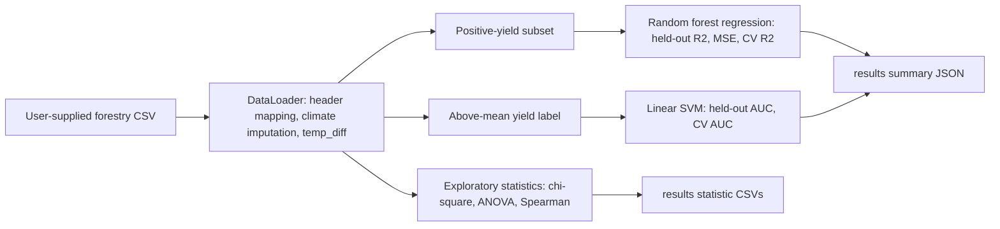

# Forestry Crop Suitability and Yield Analysis

[한국어](README.ko.md) · [Case study](PORTFOLIO.md)

This project links soil, climate, and production data for seven short-rotation
forest crops (such as chestnut, yam, and blackberry) to suggest where each crop
is likely to do well, and presents the result as a map-based recommendation
concept.

**Decision question.** A prospective forester has to choose a crop and a site
first. Which soil and climate conditions go with above-average production for
each crop, and which regions match them?

**Headline finding.** No single model fit every crop. After statistical
screening, the final report chose SVM for yam, random forest for blackberry,
fresh shiitake, deodeok, and acanthopanax, and logistic regression for chestnut
and balloon flower. The retained ROC figures show AUC 0.94 for chestnut, 0.91
for yam, and 0.84 for blackberry when classifying above-mean production. Each
test set was very small: the curves move in true-positive-rate steps of 0.2 to
0.5, which means roughly 2 to 5 positive cases. Read these AUCs as noisy
historical results, not benchmarks.

**Recognition.** Grand Prize (Korea Forest Service Commissioner Award, first
place), 2024 Forestry Statistics Smart Use Competition, Korea Forest Service
and Korea Forestry Promotion Institute (13 Dec 2024). Team entry; this
repository does not record the per-person split of work.

> **Evidence boundary:** the raw analysis CSV is not included. The repository
> contains source links, notebooks, code, report PDFs, and retained figures,
> but it cannot reproduce the historical scores without the original input
> data and its column headers.

## Problem

The workflow screens soil and climate variables against positive production,
predicts production for positive-yield rows, and classifies observations as
suitable when production is at or above the crop mean.

## Data boundary

`data/임업통계 데이터 셋 출처(이준형).txt` lists forestry-statistics, soil,
climate, and production-data sources. It does not contain the analysis CSV, so
the row count, time coverage, geographic unit, target definition, and original
train/test split cannot be checked from this repository.

`src/data_loader.DataLoader` expects either the historical Korean headers it
maps or already-English names such as `chestnut_kg`, `avg_temp`, `humidity`,
and `precipitation`. It fills missing climate values with each column mean and
derives `temp_diff` when maximum and minimum temperatures are available.

## Maintained workflow



## Methodology

| Stage | Maintained implementation |
|---|---|
| Statistical checks | `StatAnalyzer` tests soil-category associations against quantile-binned positive yield, runs one-way ANOVA across eligible groups, and reports Spearman correlations. These are exploratory tests, not causal estimates. |
| Regression | `CropPredictor` filters to positive production, one-hot encodes supplied features, then fits a median-imputation + random-forest pipeline. It reports an 80/20 held-out R²/MSE and shuffled CV R² with seed 42. |
| Suitability classification | `CropClassifier` defines suitability as production at or above the full-input mean, then applies imputation, scaling, and a linear SVM inside one pipeline. It uses a stratified 80/20 split and stratified CV with seed 42. |
| Outputs | `run_pipeline.py` saves Chi-square, ANOVA, Spearman tables and a JSON model summary under `results/`. |

## Retained visual evidence

The next two figures were rendered directly from the checked-in presentation
PDF (`reports/*_ppt.pdf`), rather than recreated from the unavailable raw
data.


*Figure 1. Presentation page 8 documents the historical data design: soil and
climate inputs for crop/location recommendation, plus sales/price and regional
production inputs for the companion information views. It establishes intended
data scope, not a currently reproducible data integration run.*


*Figure 2. Presentation page 23 retains market-trend and regional-production
map examples. These are historical interface/analysis artifacts, not evidence
of a deployed service or a current prediction output.*


*Figure 3. The checked-in concept collage shows the intended map,
recommendation, and market-information interface. It is a design artifact; no
deployed web application is verified in this repository.*


*Figure 4. The retained heatmap visualizes correlations among climate variables
and crop-production columns in a filtered historical dataset. It supports
exploration only and does not establish that changing a variable changes yield.*


*Figure 5. The checked-in chestnut ROC image is labeled AUC 0.94. The curve
rises in steps of 0.2, so the test set held about five positive cases. The raw
split and exact configuration are unavailable, so it is a historical project
artifact rather than a current reproducibility benchmark.*

## Historical results retained in the repository

| Crop | Model chosen in the report | Retained ROC-image AUC | Approx. positives in test set | Evidence |
|---|---|---:|---:|---|
| Chestnut | Logistic regression | 0.94 | 5 | `images/roc_chestnut.png`; not rerun |
| Yam | SVM | 0.91 | 2 | `images/roc_yam.png`; not rerun |
| Blackberry | Random forest | 0.84 | 4 | `images/roc_blackberry.png`; not rerun |

The positive counts are read from the step size of each ROC curve, not from a
saved split. Each image's title names only the crop, not the model that drew it. The comparison point is the chance diagonal (AUC 0.5) drawn on
each figure; the report does not record a majority-class or single-variable
baseline. The report's model choice for each crop (SVM, random forest, or
logistic regression) comes from its own AUC comparison, which is not retained
as a table.

How the report screened variables before modelling:

- Soil variables (categorical): chi-square and ANOVA, keeping variables with
  p < 0.1.
- Climate variables: correlation with production, keeping |r| >= 0.2.
- Domain check: top variables were compared with cultivation guidance. For
  example, the leading soil variable for chestnut was the loam texture code,
  which matches standard chestnut growing advice.

## Run

```powershell
pip install -r requirements.txt

python run_pipeline.py `
  --input-csv path\to\forestry_data.csv `
  --crop chestnut_kg `
  --features avg_temp humidity precipitation soil_depth_type soil_texture_code
```

If the CSV uses different mapped headers, pass them explicitly through
`--crop` and `--features`. `--encoding` defaults to `cp949` and then attempts
UTF-8 variants if needed.

The command creates `results/` and writes `<crop>_chi_square.csv`,
`<crop>_anova.csv`, `<crop>_spearman.csv`, and `<crop>_summary.json`.

## Repository structure

```text
src/                  # Configuration, loading, statistics, and models
run_pipeline.py        # CLI entry point and result persistence
notebooks/             # Historical exploratory notebooks
images/                # Retained dashboard, heatmap, and ROC artifacts
reports/               # Historical report PDFs
data/                  # Source notes; raw analysis CSV excluded
```

## Limitations and next steps

- Supply a versioned raw dataset and data dictionary before interpreting a
  metric as externally valid.
- Record geographic/time splits; spatial or temporal leakage is not assessed.
- Confirm the business definition of “suitable”; the classifier uses the
  repository's above-mean-production rule, not an agronomic threshold.
- Add a baseline, calibration, uncertainty intervals, and saved model
  artifacts before operational use.
- Treat category-factorized Spearman and multiple hypothesis tests as
  exploratory; apply domain review and multiple-testing controls for research.
- The historical code in the report standardises features on the full dataset
  before splitting (a minor leak). The maintained classifier fits scaling
  inside the training pipeline instead.
- No licence file is included, so the code is all rights reserved by default.

## Documentation

- [Portfolio case study](PORTFOLIO.md)
- [Project review](docs/PROJECT_REVIEW.md)
- [Architecture](docs/ARCHITECTURE.md)
- [CV bullet guidance](docs/CV_BULLETS.md)
