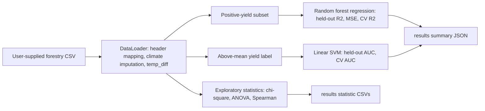

# Forestry Crop Suitability and Yield Analysis

[한국어](README.ko.md) · [Case study](PORTFOLIO.md)

Suitability analysis and a map-based service concept for seven short-cycle
non-timber forest crops, linking soil, climate, and production data (GIS soil
and soil-moisture shapefiles processed with GeoPandas).

**Problem.** New forest farmers must pick a crop and a site first, but soil,
climate, and production data sit in separate public sources. Which conditions
go with above-average production for each crop, and which regions match them?

**Result.** Test AUC for above-mean production: 0.94 for chestnut, 0.91 for
yam, and 0.84 for blackberry (chance level 0.5; no majority-class baseline was run). No single model fit every crop:
logistic regression for chestnut, SVM for yam, random forest for blackberry.

**Role.** Team entry; I wrote the analysis code and documentation in this repository.

**Scope.** Test sets held about 2 to 5 positive cases, so model differences are
within AUC noise. The CLI (`python run_pipeline.py`) re-implements only the
screening statistics, a random-forest regression, and a linear-SVM
classifier; the per-crop
model choices and AUCs above come from the competition-era analysis (ROC
figures in `images/`), whose CSV is not included.

**Recognition.** Grand Prize (Korea Forest Service Commissioner Award, first
place), 2024 Forestry Statistics Smart Use Competition, Korea Forest Service
and Korea Forestry Promotion Institute (13 Dec 2024).

## Results

| Crop | Chosen model | Test AUC | Approx. positives in test set |
|---|---|---:|---:|
| Chestnut | Logistic regression | 0.94 | 5 |
| Yam | SVM | 0.91 | 2 |
| Blackberry | Random forest | 0.84 | 4 |

Each crop's model was chosen by comparing SVM, random forest, and logistic
regression on AUC. Random forest was also chosen for fresh shiitake, deodeok,
and acanthopanax, and logistic regression for balloon flower. Positive counts
are read from each ROC curve's step size (`images/roc_*.png`).

Variable screening:

- Soil variables (categorical): chi-square and ANOVA, keeping p < 0.1.
- Climate variables: correlation with production, keeping |r| >= 0.2.
- Domain check: the leading soil variable for chestnut was the loam texture
  code, which matches standard chestnut growing advice.

## How it works

Screens soil and climate variables, predicts production for positive-yield
rows, and labels a row suitable when production is at or above the crop mean.
Sources: `data/임업통계 데이터 셋 출처(이준형).txt`.



| Stage | Implementation |
|---|---|
| Loading | `DataLoader` maps the original Korean headers or accepts English names such as `chestnut_kg`, `avg_temp`, `humidity`, and `precipitation`. It fills missing climate values with column means and derives `temp_diff` from maximum and minimum temperature. |
| Statistical checks | `StatAnalyzer`: soil-category association with quantile-binned positive yield, one-way ANOVA, Spearman correlations. |
| Regression | `CropPredictor` keeps positive production, one-hot encodes features, and fits a median-imputation + random-forest pipeline. Reports 80/20 holdout R²/MSE and shuffled CV R² (seed 42). |
| Suitability classification | `CropClassifier` labels production at or above the training-split mean (the same cut-off is applied to the test split) as suitable, then runs imputation, scaling, and a linear SVM in one pipeline with a stratified 80/20 split and stratified CV (seed 42). |
| Outputs | `run_pipeline.py` saves chi-square, ANOVA, and Spearman tables and a JSON model summary under `results/`. |

## Figures


*Figure 1. Presentation page 8: soil and climate inputs for crop and site
recommendation, plus sales, price, and regional production inputs for the
companion information views.*


*Figure 2. Correlations among climate variables and crop-production columns.*


*Figure 3. Chestnut ROC curve, AUC 0.94. It rises in steps of 0.2, so the test
set held about five positive cases.*

## How to run

```powershell
pip install -r requirements.txt

python run_pipeline.py `
  --input-csv path\to\forestry_data.csv `
  --crop chestnut_kg `
  --features avg_temp humidity precipitation soil_depth_type soil_texture_code
```

Pass other headers through `--crop` and `--features`; `--encoding` defaults to
`cp949`, then tries UTF-8. Writes `<crop>_chi_square.csv`, `<crop>_anova.csv`,
`<crop>_spearman.csv`, and `<crop>_summary.json` to `results/`.

The notebooks ran on Python 3.12.4 (Anaconda). `requirements.txt` pins pandas,
numpy, scipy, and matplotlib to the versions their pip output records;
scikit-learn was not recorded and is pinned to the 2026-11 review environment.

## Repository layout

```text
src/                  # Configuration, loading, statistics, and models
run_pipeline.py        # CLI entry point and result persistence
notebooks/             # Exploratory and GIS notebooks
images/                # Dashboard, heatmap, and ROC figures
reports/               # Final report and presentation (Korean PDFs)
data/                  # Source notes; raw analysis CSV not included
```

## Limitations

- Test sets held about 2 to 5 positive cases, so per-crop model differences are within AUC noise; the analysis CSV is not included, so the AUCs cannot be rerun.
- AUCs survive for only three of the seven crops, with no per-model comparison table.
- No spatial or temporal holdout; nearby regions may appear in both train and test sets.
- "Suitable" means at or above the crop mean, a statistical cut-off rather than an agronomic threshold, and the grades show association, not that changing a condition changes yield.

## Next steps

- Evaluate with leave-one-region-out splits, report AUC with bootstrap
  intervals, and add majority-class and single-variable baselines.
- Replace the above-mean label with an agronomic threshold agreed with a domain
  expert, then compare the map against known cultivation sites.

## Documentation

- [Case study](PORTFOLIO.md)
- [Architecture](docs/ARCHITECTURE.md)

## License

No open-source license: the code and documents are public for review; reuse requires permission.
