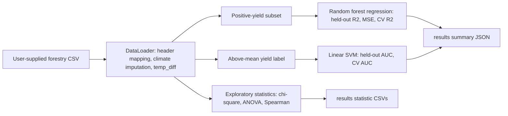

# Forestry Crop Suitability and Yield Analysis

[한국어](README.ko.md) · [Case study](PORTFOLIO.md)

Links soil, climate, and production data for seven short-rotation forest crops
(such as chestnut, yam, and blackberry), including GIS soil and soil-moisture
shapefiles processed with GeoPandas, to find where each crop is likely to do
well. The result is presented as a map-based recommendation concept.

**Decision question.** Which soil and climate conditions go with above-average
production for each crop, and which regions match them?

**Result.** No single model fit every crop. The final report chose SVM for yam,
random forest for blackberry, fresh shiitake, deodeok, and acanthopanax, and
logistic regression for chestnut and balloon flower. Retained ROC figures show
AUC 0.94 (chestnut), 0.91 (yam), and 0.84 (blackberry) for classifying
above-mean production, on test sets of about 2 to 5 positive cases.

**Recognition.** Grand Prize (Korea Forest Service Commissioner Award, first
place), 2024 Forestry Statistics Smart Use Competition, Korea Forest Service
and Korea Forestry Promotion Institute (13 Dec 2024). Team entry.

## How it works

Screens soil and climate variables, predicts production for positive-yield
rows, and labels a row suitable when production is at or above the crop mean.
Sources: `data/임업통계 데이터 셋 출처(이준형).txt`.



| Stage | Implementation |
|---|---|
| Loading | `DataLoader` maps the historical Korean headers or accepts English names such as `chestnut_kg`, `avg_temp`, `humidity`, and `precipitation`. It fills missing climate values with column means and derives `temp_diff` from maximum and minimum temperature. |
| Statistical checks | `StatAnalyzer`: soil-category association with quantile-binned positive yield, one-way ANOVA, Spearman correlations. |
| Regression | `CropPredictor` keeps positive production, one-hot encodes features, and fits a median-imputation + random-forest pipeline. Reports 80/20 held-out R²/MSE and shuffled CV R² (seed 42). |
| Suitability classification | `CropClassifier` labels production at or above the full-input mean as suitable, then runs imputation, scaling, and a linear SVM in one pipeline with a stratified 80/20 split and stratified CV (seed 42). |
| Outputs | `run_pipeline.py` saves chi-square, ANOVA, and Spearman tables and a JSON model summary under `results/`. |

## Figures

Figures 1 and 2 are rendered from the presentation PDF (`reports/*_ppt.pdf`).


*Figure 1. Presentation page 8: soil and climate inputs for crop/location
recommendation, plus sales/price and regional production inputs for the
companion information views.*


*Figure 2. Presentation page 23: market-trend and regional-production map
examples.*


*Figure 3. Concept collage of the map, recommendation, and market-information
interface.*


*Figure 4. Correlations among climate variables and crop-production columns in
the filtered historical dataset.*


*Figure 5. Chestnut ROC curve, labeled AUC 0.94. It rises in steps of 0.2,
so the test set held about five positive cases.*

## Results

| Crop | Model chosen in the report | ROC-image AUC | Approx. positives in test set | Source |
|---|---|---:|---:|---|
| Chestnut | Logistic regression | 0.94 | 5 | `images/roc_chestnut.png` |
| Yam | SVM | 0.91 | 2 | `images/roc_yam.png` |
| Blackberry | Random forest | 0.84 | 4 | `images/roc_blackberry.png` |

Positive counts are read from each ROC curve's step size; the comparison point
is the chance diagonal (AUC 0.5). The report chose each crop's model by its own
AUC comparison.

Variable screening in the report:

- Soil variables (categorical): chi-square and ANOVA, keeping p < 0.1.
- Climate variables: correlation with production, keeping |r| >= 0.2.
- Domain check: the leading soil variable for chestnut was the loam texture
  code, which matches standard chestnut growing advice.

## Run

```powershell
pip install -r requirements.txt

python run_pipeline.py `
  --input-csv path\to\forestry_data.csv `
  --crop chestnut_kg `
  --features avg_temp humidity precipitation soil_depth_type soil_texture_code
```

Pass other headers through `--crop` and `--features`; `--encoding` defaults to
`cp949`, then tries UTF-8. Writes `<crop>_chi_square.csv`, `<crop>_anova.csv`,
`<crop>_spearman.csv`, and `<crop>_summary.json` to `results/`.

## Repository structure

```text
src/                  # Configuration, loading, statistics, and models
run_pipeline.py        # CLI entry point and result persistence
notebooks/             # Historical exploratory and GIS notebooks
images/                # Retained dashboard, heatmap, and ROC artifacts
reports/               # Historical report PDFs
data/                  # Source notes; raw analysis CSV excluded
```

## Limitations

- The analysis CSV is not included, so row count, period, geographic unit, and the original split cannot be checked, and the AUCs above are not rerun.
- Test sets held about 2 to 5 positive cases (ROC true-positive-rate steps of 0.2 to 0.5), so per-crop model differences are within AUC noise.
- AUCs for the other four crops and the per-model comparison table are not retained; ROC image titles name the crop, not the model.
- No majority-class or single-variable baseline, calibration, uncertainty intervals, or saved model artifacts.
- No spatial or temporal hold-out; nearby regions may appear in both train and test sets.
- "Suitable" means at or above the crop mean, a statistical cut-off rather than an agronomic threshold.
- Screening used loose thresholds and many tests without multiple-testing correction; category-factorized Spearman is exploratory.
- Correlations and importances show association, not that changing a condition changes yield.
- The report's original code standardised features on the full dataset before splitting (a minor leak); the maintained classifier scales inside the training pipeline.
- The map and dashboard are design concepts; no deployed service.
- No licence file, so the code is all rights reserved by default.

## Documentation

- [Portfolio case study](PORTFOLIO.md)
- [Project review](docs/PROJECT_REVIEW.md)
- [Architecture](docs/ARCHITECTURE.md)
- [CV bullet guidance](docs/CV_BULLETS.md)
